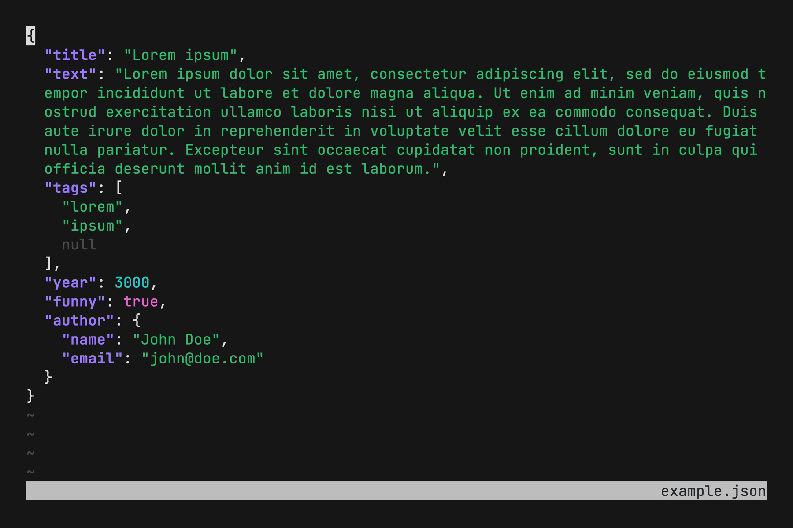

# f(x)

<p align="center"><a href="https://fx.wtf"></a></p>

## Documentation

See full documentation at [fx.wtf](https://fx.wtf).

## Search history

Use Up and Down in the `/` search input to recall earlier searches. The query
input keeps a separate history. Both histories keep the last 100 entries.

Set `FX_HISTORY_FILE` to save these histories between sessions:

```sh
export FX_HISTORY_FILE="$HOME/.fx_history"
```

The parent directory must already exist. The file contains JSON and is created
with owner-only permissions. An unset or empty variable keeps history in memory.
Only inputs submitted with Enter are saved. Fuzzy JSON path selections (`@`) are
not saved. Concurrent sessions use the last saved history.

## Related

- [walk](https://github.com/antonmedv/walk) – terminal file manager
- [howto](https://github.com/antonmedv/howto) – terminal command LLM helper
- [countdown](https://github.com/antonmedv/countdown) – terminal countdown timer

## License

[MIT](LICENSE)
